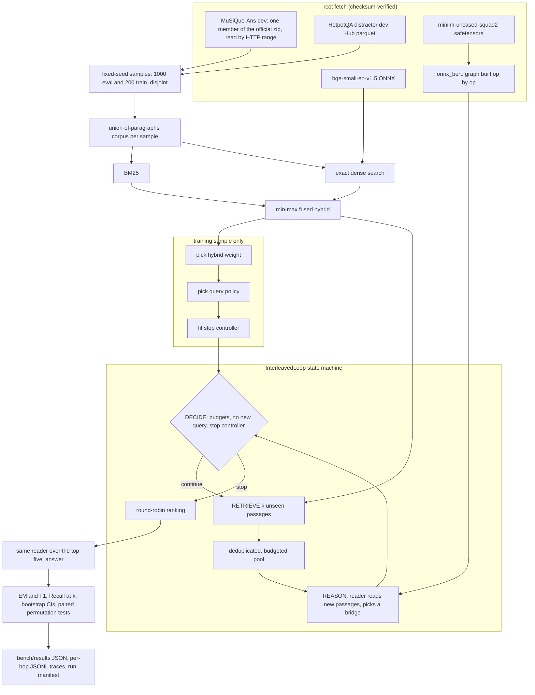

# ircot-multihop-retrieval

A CPU-only reproduction of the retrieval side of IRCoT (Trivedi et al., *Interleaving Retrieval
with Chain-of-Thought Reasoning for Knowledge-Intensive Multi-Step Questions*, ACL 2023) on
MuSiQue and HotpotQA. The loop retrieves, reads, picks a bridge entity, re-queries, and a learned
controller decides when to stop. The reasoner is pluggable: the measured one is an extractive
SQuAD v2.0 reader, so the repository can separate what iterating buys from what the reasoner buys,
and what each costs in retrieval calls and latency.

No LLM was run for any number in this README. The chain-of-thought reasoner from the paper is
implemented behind an OpenAI-compatible provider interface and is reported as **not run**.

## The claim sheet

The paper's claims are paraphrased from its abstract; no number from the paper is copied here.
"Our measurement" refers to the tables under [Measurements](#measurements).

| # | Paper claim (paraphrased) | Our measurement | Reproduced? |
|---|---|---|---|
| 1 | Interleaving retrieval with reasoning retrieves more of the supporting paragraphs than retrieving once with the question. | `ircot-extractive` vs `oneshot-*` Recall@5 and Recall@10, MuSiQue and HotpotQA | pending benchmark |
| 2 | The better retrieval carries through to better final answers. | EM/F1 of one fixed extractive reader over each configuration's top five passages | pending benchmark |
| 3 | The gains also appear with much smaller models than the largest one tested. | The reasoner here is a 33M-parameter extractive reader that generates no text at all | pending benchmark |
| 4 | The improvement holds on each of several multi-hop QA datasets (the paper uses four). | Two datasets here; MuSiQue also split by 2, 3 and 4 hops, HotpotQA by bridge and comparison questions | pending benchmark |
| 5 | Grounding the chain of thought in retrieved text reduces factual errors in it. | Needs an LLM reasoner | not run |
| 6 | The gains carry over to out-of-distribution settings. | Every choice here is made per dataset; no cross-dataset transfer was run | not run |
| - | *Not a paper claim, this repository's question:* is the gain from iterating at all, or from what the reasoner reads? | `loop2-title-feedback` (iterates, reads nothing) vs `loop2-extractive` vs `loop-oracle-bridge` (gold bridges) | pending benchmark |

## How the loop works



**States.** `RETRIEVE` asks the retriever for `k` passages that are not already pooled. The pool
skips duplicates by id and by a text fingerprint and refuses passages that would overflow its
token budget. `REASON` hands the newly admitted passages to the reasoner, which returns the next
query or none. `DECIDE` checks, in order: the step budget, the pool token and passage budgets, the
reasoner's own token budget, whether the reasoner says it is done, whether it has a new query,
and finally the stop controller. On the last allowed step the loop skips `REASON`.

**Reasoners** (`ircot/reasoners.py`):

| reasoner | reads | next query from |
|---|---|---|
| `extractive` | top 3 new passages per hop, with the original question | the best unused reader span; spans that equal another passage's title get a bonus |
| `title-feedback` | nothing | question + title of the best new passage |
| `oracle-bridge` | nothing | MuSiQue's gold intermediate answer for that hop (a ceiling, not a method) |
| `chain-of-thought` | the pooled paragraphs, through an LLM | the newest reasoning sentence, as in the paper (**not run**) |

**Query policies** (`ircot/policies.py`) turn a bridge into a query: `append` (question + bridge),
`residual` (bridge + the question words the evidence passage did not cover) and `sentence` (the
evidence sentence the bridge came from, the closest analogue of IRCoT querying with its latest
chain-of-thought sentence). One is chosen per dataset on the training sample.

**Stop controller** (`ircot/controller.py`): a logistic regression on nine per-hop features
(hop, reader margin and its change, answer stability, bridge found, bridge matched a title,
novelty of the hop, top fused score, question-term coverage). It is fitted with Newton's method
on the training sample's traces, labelled 1 where no later hop adds a gold passage. See
[ADR 0004](docs/adr/0004-stop-label-and-newton-logistic-regression.md).

Every question writes a JSONL trace with one record per hop: the query, every hit and its score,
what the pool admitted or refused and why, the bridge, the features, the stop probability and the
decision. Each run also writes a manifest with the config hash, dataset checksums, model hashes,
git SHA and machine.

## Run it

Python 3.12 and [uv](https://docs.astral.sh/uv/) are the only prerequisites.

```bash
uv sync
uv run ircot demo                 # offline: synthetic world, hashing encoder, lexical reader

export IRCOT_DATA_DIR=~/.cache/ircot-multihop-retrieval   # the default; any path works
uv run ircot fetch                # datasets, both models, the official MuSiQue evaluator
uv run ircot info                 # what is present
```

`ircot fetch` transfers about 7 MB of MuSiQue (out of a 272 MB archive), 27 MB of HotpotQA,
the 133 MB bge-small ONNX file and the 133 MB reader weights; it then writes the reader's ONNX
graph (another 133 MB). Models go through the Hugging Face cache (`HF_HOME`), so a copy that is
already cached is reused.

The full benchmark, everything in [Measurements](#measurements), is one command:

```bash
uv run ircot bench --out bench/results/full.json
uv run ircot report bench/results/full.json          # the Markdown tables below
uv run ircot ask 2hop__259228_793698 --results bench/results/full.json   # one question, hop by hop
```

Defaults: 1,000 evaluation and 200 training questions per dataset (seed 2026), 30 questions
re-timed with a cold reader cache for latency, 2,000 bootstrap resamples and 10,000 sign-flip
permutations. Traces and the manifest go to `$IRCOT_DATA_DIR/runs/<date>-<config hash>/`.

A container runs the same CLI as uid 10001; mount a volume for the data:

```bash
docker build -t ircot .
docker run --rm ircot                                   # offline demo
docker run --rm -v ircot-data:/data ircot fetch
docker run --rm -v ircot-data:/data ircot bench --out /data/full.json
```

To try the chain-of-thought reasoner against a local model, construct
`ChainOfThoughtReasoner(OpenAICompatibleProvider("http://localhost:11434/v1", "<model>"), corpus)`
and pass it to `InterleavedLoop`; any OpenAI-compatible server works (OpenAI, Ollama, vLLM, LM
Studio). The API key, if one is needed, is read from `IRCOT_LLM_API_KEY`.

## Measurements

Measured on: Intel i5-8500 (6 cores), 12 GB RAM, Windows 10, CPU only. Date: pending benchmark.

All numbers below will come from `bench/results/full.json`; until the full run exists every cell
reads "pending benchmark". Recall is the fraction of a question's gold supporting paragraphs in
the first k of the ranking; EM/F1 use SQuAD normalisation with MuSiQue's answer aliases;
brackets are 95% percentile bootstrap intervals over questions. The results file also holds
`recall@pool` (recall of everything the loop retrieved) and `complete@10` (share of questions
with every gold paragraph in the first ten).

### MuSiQue-Ans dev, 1,000 questions

| configuration | R@2 | R@5 | R@10 | EM | F1 | retrieval calls | reader passages | p50 ms | p95 ms |
|---|---|---|---|---|---|---|---|---|---|
| oneshot-bm25 | pending benchmark | | | | | | | | |
| oneshot-dense | pending benchmark | | | | | | | | |
| oneshot-hybrid | pending benchmark | | | | | | | | |
| loop2-title-feedback | pending benchmark | | | | | | | | |
| loop2-extractive | pending benchmark | | | | | | | | |
| loop3-extractive | pending benchmark | | | | | | | | |
| ircot-extractive | pending benchmark | | | | | | | | |
| loop-oracle-bridge | pending benchmark | | | | | | | | |
| ircot-cot-llm | not run | | | | | | | | |

Recall@5 by number of hops: pending benchmark.

### HotpotQA distractor dev, 1,000 questions

| configuration | R@2 | R@5 | R@10 | EM | F1 | retrieval calls | reader passages | p50 ms | p95 ms |
|---|---|---|---|---|---|---|---|---|---|
| oneshot-bm25 | pending benchmark | | | | | | | | |
| oneshot-dense | pending benchmark | | | | | | | | |
| oneshot-hybrid | pending benchmark | | | | | | | | |
| loop2-title-feedback | pending benchmark | | | | | | | | |
| loop2-extractive | pending benchmark | | | | | | | | |
| loop3-extractive | pending benchmark | | | | | | | | |
| ircot-extractive | pending benchmark | | | | | | | | |
| ircot-cot-llm | not run | | | | | | | | |

Recall@5 by question type (bridge, comparison): pending benchmark.

### Against one-shot hybrid

Paired differences with bootstrap intervals and two-sided sign-flip permutation p-values, per
dataset: pending benchmark.

### Choices made on the training sample

Hybrid dense weight, selected query policy and the stop controller's coefficients, per dataset:
pending benchmark.

## Where this departs from the paper

- **Reasoner.** The paper prompts an LLM to write one chain-of-thought sentence per step. Here the
  measured reasoner is an extractive reader plus bridge-entity selection; it cannot paraphrase,
  compare or count. The LLM reasoner exists in code and is not run.
- **Query.** The paper queries with the newest chain-of-thought sentence. Here that corresponds to
  the `sentence` policy; `append` and `residual` are alternatives, and the policy used in the
  evaluation is whichever won on the training sample.
- **Stopping.** The paper stops when the model writes an answer or reaches a step limit. Here a
  learned controller decides, inside hard step and token budgets.
- **Retriever.** The paper uses BM25 (Elasticsearch). Here BM25 is implemented from scratch and
  the loops run on a BM25 plus bge-small hybrid; one-shot BM25 and dense are both reported.
- **Corpus.** The paper retrieves from full dataset corpora (Wikipedia abstracts for HotpotQA).
  Here each sample retrieves from the union of its own questions' paragraphs, roughly ten to
  fifteen thousand passages ([ADR 0001](docs/adr/0001-shared-corpus-and-a-separate-training-sample.md)).
- **Datasets and splits.** MuSiQue-Ans and HotpotQA only (the paper also uses 2WikiMultihopQA and
  IIRC), 1,000-question fixed-seed samples of the dev sets, no test sets.
- **Answering.** The paper answers with the LLM. Here one fixed extractive reader answers every
  configuration from its top five passages
  ([ADR 0003](docs/adr/0003-one-ranking-and-one-answer-step-for-every-configuration.md)).
- **Recall.** Recall@k is computed on a round-robin ranking of the pool; recall of the whole pool,
  closer to the paper's view of all retrieved paragraphs, is in the results file as `recall@pool`.
- **No demonstrations.** There is no few-shot prompting anywhere.

## Known gaps

- HotpotQA comparison questions are often answered "yes" or "no"; an extractive reader cannot
  produce either, so their EM is close to zero for every configuration.
- The reader answers the original multi-hop question. When a passage holding the bridge entity
  outranks the passage holding the answer, the bridge comes back as the answer.
- Bridge selection keys on Wikipedia-style titles. Questions whose next hop is not about a named
  entity (dates, quantities, descriptions) give the extractive reasoner little to link.
- The union corpus is far smaller than the paper's corpora, so absolute recall is not comparable
  with published figures.
- The stop controller is trained per dataset on 200 questions; its label only looks four steps
  ahead.
- Latency is measured on a 30-question subset per configuration on a shared desktop CPU; the
  accuracy pass shares a reader cache across configurations and is not timed.
- The reader graph uses onnxruntime's fused contrib operators, so it runs on onnxruntime only
  ([ADR 0002](docs/adr/0002-reader-onnx-graph-built-from-safetensors.md)).

## Data, models and licences

| asset | source | licence | in this repository |
|---|---|---|---|
| MuSiQue-Ans v1.0 dev | official Google Drive zip linked from `StonyBrookNLP/musique` | `CC BY 4.0` | no, fetched and sha256-verified |
| HotpotQA distractor dev | `hotpotqa/hotpot_qa` on the Hugging Face Hub (the original host did not respond) | `CC BY-SA 4.0` | no, fetched and sha256-verified |
| BAAI/bge-small-en-v1.5 (ONNX) | Hugging Face Hub, pinned revision | MIT | no |
| deepset/minilm-uncased-squad2 | Hugging Face Hub, pinned revision, exported to ONNX locally | `CC BY 4.0` | no |
| MuSiQue evaluator (`evaluate_v1.0.py`, `metrics/`) | `StonyBrookNLP/musique` at a pinned commit, used only by tests | `CC BY 4.0` | no, fetched for parity tests |

`tests/fixtures/musique_answer_cases.json` holds outputs of the official evaluator on 25
hand-written strings, recorded with `bench/record_metric_cases.py`. The synthetic world used by
the default tests, CI and the container is generated by `ircot/offline.py` and contains no
dataset text. The code is MIT licensed.

## Tests

```bash
uv run pytest                    # default suite: fixtures and fakes, no network, under a minute
uv run pytest -m integration     # needs `ircot fetch`: real reader, encoder, datasets, evaluator
```

The default suite drives the loop with a scripted reasoner through every budget and stop path,
checks the hand-built ONNX graph against an independent NumPy BERT, compares EM/F1 with recorded
official-evaluator outputs and Recall@k with `ir-measures`, compares the Newton logistic fit with
scikit-learn, uses hypothesis for invariants (Recall@k monotone in k, pool budget never exceeded,
F1 symmetric and bounded, top-k equal to the sorted prefix), exercises the zip-range fetcher
against a local server with and without range support, and runs the whole benchmark offline on
the 30-question synthetic fixture. CI runs lint, format, the default suite, the offline benchmark,
a docker build and a smoke run of the image.

## Layout

```
src/ircot/
  sources.py   pinned downloads, zip-member range fetch       onnx_bert.py  reader graph builder
  data.py      loaders, samples, union corpus                 retrieval.py  BM25, dense, hybrid
  reader.py    windowed SQuAD v2.0 span reader                 encoders.py   bge-small encoder
  pool.py      deduplicated budgeted pool                     bridge.py     title-linked bridges
  policies.py  query formulation                              reasoners.py  the four reasoners
  controller.py  stop controller                              loop.py       the state machine
  llm.py       provider interface and HTTP adapter            harness.py    the benchmark
  sessions.py  onnxruntime CPU sessions                        offline.py    CI stand-ins, synthetic world
  metrics.py, stats.py, manifest.py, report.py, cli.py
docs/adr/      decision records
bench/results/ results files written by `ircot bench`
```

Decision records: [0001 corpus and training sample](docs/adr/0001-shared-corpus-and-a-separate-training-sample.md),
[0002 reader export](docs/adr/0002-reader-onnx-graph-built-from-safetensors.md),
[0003 ranking and answer step](docs/adr/0003-one-ranking-and-one-answer-step-for-every-configuration.md),
[0004 stop controller](docs/adr/0004-stop-label-and-newton-logistic-regression.md),
[0005 data sources](docs/adr/0005-fetching-musique-by-range-and-hotpotqa-from-the-hub.md).
