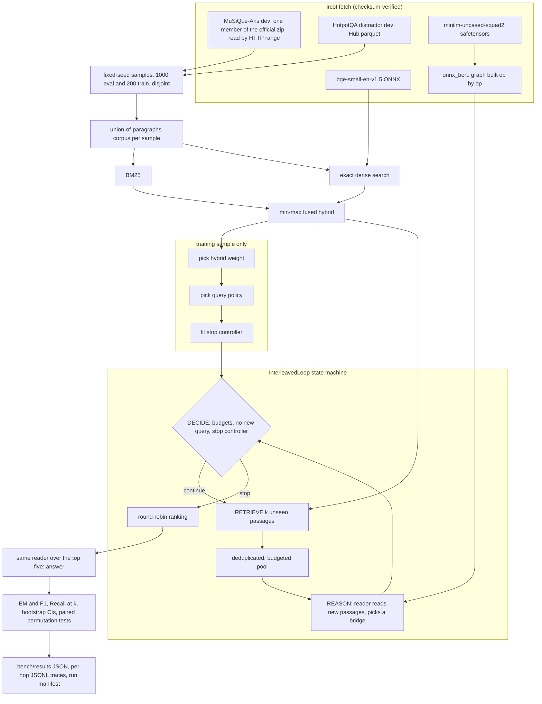

# ircot-multihop-retrieval

[](https://github.com/daniellopez882/ircot-multihop-retrieval/actions/workflows/ci.yml)  

A CPU-only reproduction of the retrieval side of IRCoT (Trivedi et al., *Interleaving Retrieval
with Chain-of-Thought Reasoning for Knowledge-Intensive Multi-Step Questions*, ACL 2023) on
MuSiQue and HotpotQA. The loop retrieves, reads, picks a bridge entity, re-queries, and a learned
controller decides when to stop. The reasoner is pluggable: the measured one is an extractive
SQuAD v2.0 reader, so the repository can separate what iterating buys from what the reasoner buys,
and what each costs in retrieval calls and latency.

No LLM was run for any number in this README. The chain-of-thought reasoner from the paper is
implemented behind an OpenAI-compatible provider interface and is reported as **not run**.

## The claim sheet

The paper's claims are paraphrased from its abstract; no number from the paper is copied here.
"Our measurement" refers to the tables under [Measurements](#measurements).

| # | Paper claim (paraphrased) | Our measurement | Reproduced? |
|---|---|---|---|
| 1 | Interleaving retrieval with reasoning retrieves more of the supporting paragraphs than retrieving once with the question. | MuSiQue: `ircot-extractive` R@5 55.2 against 53.7 for `oneshot-hybrid` (+1.5 points, p 0.009); `loop2-extractive` R@10 65.9 against 61.0. HotpotQA: `ircot-extractive` R@5 85.5 against 84.9 (+0.7, p 0.021); `loop2-extractive` R@10 94.8 against 91.6. | Partly. The direction holds on both datasets, but the gains are 0.7 to 4.9 points, against 16.4 for gold bridges. |
| 2 | The better retrieval carries through to better final answers. | F1 of the shared reader over the top five: `ircot-extractive` 18.5 against 17.3 on MuSiQue (+1.2 [-0.2, 2.5], p 0.099) and 37.2 against 37.2 on HotpotQA (+0.1, p 0.814). Gold bridges add 5.3 F1 (p < 0.001). | No, not with this reasoner. No extractive loop changes F1 significantly. |
| 3 | The gains also appear with much smaller models than the largest one tested. | The reasoner here is a 33M-parameter extractive reader that generates no text. It gives the small retrieval gains of row 1 and no significant answer gain (row 2). | Partly: retrieval only. |
| 4 | The improvement holds on each of several multi-hop QA datasets (the paper uses four). | Both datasets show an R@5 gain. On MuSiQue it comes from 2-hop questions only: 65.3 against 61.6 at 2 hops, 50.9 against 51.4 at 3, 33.0 against 34.3 at 4. HotpotQA: 82.0 against 81.2 on bridge questions, 99.0 against 98.8 on comparison questions. | Partly. It holds per dataset but not for 3- and 4-hop questions. |
| 5 | Grounding the chain of thought in retrieved text reduces factual errors in it. | Needs an LLM reasoner | not run |
| 6 | The gains carry over to out-of-distribution settings. | Every choice here is made per dataset; no cross-dataset transfer was run | not run |
| - | *Not a paper claim, this repository's question:* is the gain from iterating at all, or from what the reasoner reads? | Against `oneshot-hybrid` R@5: `loop2-title-feedback` (iterates, reads nothing) -1.4 on MuSiQue and -1.9 on HotpotQA; `loop2-extractive` +1.7 on both; `loop-oracle-bridge` (gold bridges) +16.4 on MuSiQue. | From the reasoner. Iterating without reading loses top-five recall, and nearly all the headroom is in better bridges. |

## How the loop works



**States.** `RETRIEVE` asks the retriever for `k` passages that are not already pooled. The pool
skips duplicates by id and by a text fingerprint and refuses passages that would overflow its
token budget. `REASON` hands the newly admitted passages to the reasoner, which returns the next
query or none. `DECIDE` checks, in order: the step budget, the pool token and passage budgets, the
reasoner's own token budget, whether the reasoner says it is done, whether it has a new query,
and finally the stop controller. On the last allowed step the loop skips `REASON`.

**Reasoners** (`ircot/reasoners.py`):

| reasoner | reads | next query from |
|---|---|---|
| `extractive` | top 3 new passages per hop, with the original question | the best unused reader span; spans that equal another passage's title get a bonus |
| `title-feedback` | nothing | question + title of the best new passage |
| `oracle-bridge` | nothing | MuSiQue's gold intermediate answer for that hop (a ceiling, not a method) |
| `chain-of-thought` | the pooled paragraphs, through an LLM | the newest reasoning sentence, as in the paper (**not run**) |

**Query policies** (`ircot/policies.py`) turn a bridge into a query: `append` (question + bridge),
`residual` (bridge + the question words the evidence passage did not cover) and `sentence` (the
evidence sentence the bridge came from, the closest analogue of IRCoT querying with its latest
chain-of-thought sentence). One is chosen per dataset on the training sample.

**Stop controller** (`ircot/controller.py`): a logistic regression on nine per-hop features
(hop, reader margin and its change, answer stability, bridge found, bridge matched a title,
novelty of the hop, top fused score, question-term coverage). It is fitted with Newton's method
on the training sample's traces, labelled 1 where no later hop adds a gold passage. See
[ADR 0004](docs/adr/0004-stop-label-and-newton-logistic-regression.md).

Every question writes a JSONL trace with one record per hop: the query, every hit and its score,
what the pool admitted or refused and why, which passages the reader read, the bridge, the features, the stop probability and the
decision. Each run also writes a manifest with the config hash, dataset checksums, model hashes,
git SHA and machine.

## Run it

Python 3.12 and [uv](https://docs.astral.sh/uv/) are the only prerequisites.

```bash
uv sync
uv run ircot demo                 # offline: synthetic world, hashing encoder, lexical reader

export IRCOT_DATA_DIR=~/.cache/ircot-multihop-retrieval   # the default; any path works
uv run ircot fetch                # datasets, both models, the official MuSiQue evaluator
uv run ircot info                 # what is present
```

`ircot fetch` transfers about 7 MB of MuSiQue (out of a 272 MB archive), 27 MB of HotpotQA,
the 133 MB bge-small ONNX file and the 133 MB reader weights; it then writes the reader's ONNX
graph (another 133 MB). Models go through the Hugging Face cache (`HF_HOME`), so a copy that is
already cached is reused.

The full benchmark, everything in [Measurements](#measurements), is one command:

```bash
uv run ircot bench --out bench/results/full.json
uv run ircot report bench/results/full.json          # the Markdown tables below
uv run ircot ask 2hop__259228_793698 --results bench/results/full.json   # one question, hop by hop
```

Defaults: 1,000 evaluation and 200 training questions per dataset (seed 2026), 30 questions
re-timed with cold caches for latency (every configuration in turn on each question), 2,000
bootstrap resamples and 10,000 sign-flip permutations. Traces and the manifest go to
`$IRCOT_DATA_DIR/runs/<date>-<config hash>/`.

A container runs the same CLI as uid 10001; mount a volume for the data:

```bash
docker build -t ircot .
docker run --rm ircot                                   # offline demo
docker run --rm -v ircot-data:/data ircot fetch
docker run --rm -v ircot-data:/data ircot bench --out /data/full.json
```

To try the chain-of-thought reasoner against a local model, construct
`ChainOfThoughtReasoner(OpenAICompatibleProvider("http://localhost:11434/v1", "<model>"), corpus)`
and pass it to `InterleavedLoop`; any OpenAI-compatible server works (OpenAI, Ollama, vLLM, LM
Studio). The API key, if one is needed, is read from `IRCOT_LLM_API_KEY`.

## Measurements

Measured on: Intel i5-8500 (6 cores), 12 GB RAM, Windows 10, CPU only, on 2026-10-14 (local
time, UTC+5), with Python 3.12.14 and onnxruntime 1.31.0. Every number in this section is copied
from [`bench/results/full.json`](bench/results/full.json) (git `000fb52`), which also records the
full machine block, package versions, dataset and model checksums, and the config hash. The run
took 2715.3 s for both datasets from cold caches, including embedding both corpora. Other desktop
applications (an IDE and a browser) were open during the run, so latency carries some background
load. To reproduce:

```bash
uv run ircot fetch
uv run ircot bench --out bench/results/full.json
uv run ircot report bench/results/full.json
```

Recall is the fraction of a question's gold supporting paragraphs in the first k of the ranking.
EM/F1 use SQuAD normalisation with MuSiQue's answer aliases. Brackets are 95% percentile
bootstrap intervals over questions. *Retrieval calls* and *reader passages* are means per
question. Reader passages counts each passage the reader processed for a question once: the
reasoner's reads plus the answer step's top five. Latency is wall time per question over the
first 30 evaluation questions, from the first retrieval to the answer, with cold reader and
query caches.

### MuSiQue-Ans dev, 1,000 questions

The corpus is the union of the sample's paragraphs: 11,535 passages.

| configuration | R@2 | R@5 | R@10 | EM | F1 | retrieval calls | reader passages | p50 ms | p95 ms |
|---|---|---|---|---|---|---|---|---|---|
| oneshot-bm25 | 35.5 | 44.8 [43.2, 46.5] | 51.2 | 8.9 | 15.6 [13.6, 17.4] | 1.00 | 5.0 | 180.45 | 467.39 |
| oneshot-dense | 37.9 | 48.8 [47.1, 50.4] | 56.6 | 9.0 | 15.6 [13.5, 17.5] | 1.00 | 5.0 | 184.56 | 272.74 |
| oneshot-hybrid | 41.3 | 53.7 [52.0, 55.3] | 61.0 | 10.1 | 17.3 [15.3, 19.3] | 1.00 | 5.0 | 184.25 | 275.15 |
| loop2-title-feedback | 32.9 | 52.3 [50.6, 54.0] | 62.0 | 11.4 | 18.6 [16.5, 20.8] | 2.00 | 5.0 | 241.77 | 307.46 |
| loop2-extractive | 35.9 | 55.4 [53.6, 57.2] | 65.9 | 10.8 | 18.3 [16.3, 20.3] | 2.00 | 5.0 | 184.73 | 266.36 |
| loop3-extractive | 35.9 | 50.7 [48.9, 52.5] | 63.1 | 8.9 | 16.2 [14.3, 18.1] | 3.00 | 7.0 | 275.41 | 367.72 |
| ircot-extractive | 39.3 | 55.2 [53.4, 56.9] | 61.2 | 10.8 | 18.5 [16.4, 20.5] | 1.58 | 5.6 | 194.57 | 290.79 |
| loop-oracle-bridge | 46.3 | 70.0 [68.3, 71.9] | 84.2 | 15.1 | 22.6 [20.3, 24.9] | 2.66 | 5.0 | 183.25 | 290.89 |
| ircot-cot-llm | not run | not run | not run | not run | not run | not run | not run | not run | not run |

Recall@5 by number of hops (2-hop n=521, 3-hop n=301, 4-hop n=178):

| configuration | 2 hops | 3 hops | 4 hops |
|---|---|---|---|
| oneshot-bm25 | 53.2 | 40.4 | 28.0 |
| oneshot-dense | 57.9 | 45.5 | 27.8 |
| oneshot-hybrid | 61.6 | 51.4 | 34.3 |
| loop2-title-feedback | 61.4 | 48.9 | 31.2 |
| loop2-extractive | 66.5 | 49.7 | 32.3 |
| loop3-extractive | 60.8 | 46.0 | 28.9 |
| ircot-extractive | 65.3 | 50.9 | 33.0 |
| loop-oracle-bridge | 82.4 | 62.6 | 46.4 |

The extractive loops beat one-shot hybrid only on 2-hop questions: `loop2-extractive` scores 66.5
and `ircot-extractive` 65.3, against 61.6. On 3- and 4-hop questions every loop except the oracle
scores below one-shot hybrid.

### HotpotQA distractor dev, 1,000 questions

The corpus is the union of the sample's paragraphs: 9,798 passages. `loop-oracle-bridge` needs
MuSiQue's decompositions and does not exist here.

| configuration | R@2 | R@5 | R@10 | EM | F1 | retrieval calls | reader passages | p50 ms | p95 ms |
|---|---|---|---|---|---|---|---|---|---|
| oneshot-bm25 | 56.2 | 70.2 [68.3, 72.0] | 83.8 | 24.6 | 34.9 [32.2, 37.7] | 1.00 | 5.0 | 213.91 | 469.65 |
| oneshot-dense | 70.2 | 83.4 [81.8, 84.9] | 88.9 | 25.5 | 36.0 [33.4, 38.9] | 1.00 | 5.0 | 217.85 | 426.79 |
| oneshot-hybrid | 71.5 | 84.9 [83.5, 86.4] | 91.6 | 26.2 | 37.2 [34.5, 40.0] | 1.00 | 5.0 | 222.17 | 360.33 |
| loop2-title-feedback | 48.9 | 83.0 [81.4, 84.5] | 92.0 | 26.7 | 37.8 [35.1, 40.6] | 2.00 | 5.0 | 230.63 | 441.0 |
| loop2-extractive | 52.8 | 86.6 [85.0, 88.0] | 94.8 | 26.3 | 37.9 [35.2, 40.8] | 2.00 | 5.0 | 203.64 | 383.7 |
| loop3-extractive | 52.8 | 79.9 [78.2, 81.6] | 92.2 | 24.6 | 35.9 [33.3, 38.9] | 3.00 | 7.0 | 296.29 | 537.3 |
| ircot-extractive | 71.5 | 85.5 [84.2, 87.1] | 86.0 | 26.1 | 37.2 [34.5, 40.1] | 1.05 | 5.0 | 169.56 | 393.75 |
| ircot-cot-llm | not run | not run | not run | not run | not run | not run | not run | not run | not run |

Recall@5 by question type:

| configuration | bridge (n=792) | comparison (n=208) |
|---|---|---|
| oneshot-bm25 | 67.5 | 80.5 |
| oneshot-dense | 79.2 | 99.3 |
| oneshot-hybrid | 81.2 | 98.8 |
| loop2-title-feedback | 79.3 | 97.1 |
| loop2-extractive | 83.7 | 97.4 |
| loop3-extractive | 76.4 | 93.0 |
| ircot-extractive | 82.0 | 99.0 |

### Against one-shot hybrid

These are paired differences in points, with 95% bootstrap intervals and two-sided sign-flip
permutation p-values (10,000 permutations, so the smallest reportable p is about 0.0001).

| MuSiQue | ΔR@5 | p | ΔF1 | p |
|---|---|---|---|---|
| oneshot-bm25 | -8.8 [-10.3, -7.4] | <0.001 | -1.7 [-3.4, -0.1] | 0.049 |
| oneshot-dense | -4.9 [-6.0, -3.8] | <0.001 | -1.8 [-3.0, -0.5] | 0.008 |
| loop2-title-feedback | -1.4 [-2.6, -0.1] | 0.039 | 1.2 [-0.4, 3.0] | 0.145 |
| loop2-extractive | 1.7 [0.2, 3.2] | 0.027 | 1.0 [-0.5, 2.5] | 0.200 |
| loop3-extractive | -3.0 [-4.9, -1.2] | 0.002 | -1.1 [-2.9, 0.8] | 0.256 |
| ircot-extractive | 1.5 [0.4, 2.7] | 0.009 | 1.2 [-0.2, 2.5] | 0.099 |
| loop-oracle-bridge | 16.4 [14.4, 18.5] | <0.001 | 5.3 [3.1, 7.4] | <0.001 |

| HotpotQA | ΔR@5 | p | ΔF1 | p |
|---|---|---|---|---|
| oneshot-bm25 | -14.7 [-16.4, -13.1] | <0.001 | -2.3 [-3.9, -0.7] | 0.008 |
| oneshot-dense | -1.5 [-2.5, -0.5] | 0.004 | -1.1 [-2.2, 0.0] | 0.064 |
| loop2-title-feedback | -1.9 [-3.4, -0.5] | 0.012 | 0.6 [-1.2, 2.3] | 0.488 |
| loop2-extractive | 1.7 [0.1, 3.2] | 0.062 | 0.7 [-1.0, 2.4] | 0.424 |
| loop3-extractive | -5.0 [-7.0, -3.0] | <0.001 | -1.2 [-3.3, 0.8] | 0.239 |
| ircot-extractive | 0.7 [0.1, 1.2] | 0.021 | 0.1 [-0.6, 0.8] | 0.814 |

What the tables say:

- **The reasoner matters more than iterating.** A second hop driven by passage titles alone
  (`loop2-title-feedback`) lowers R@5 on both datasets. The same hop driven by reader bridges
  (`loop2-extractive`) raises it by 1.7 on both (p 0.027 and 0.062). Gold bridges raise it by
  16.4 on MuSiQue.
- **More fixed hops is not better at a fixed depth.** `loop3-extractive` has the highest pool
  recall of the extractive loops (69.8 on MuSiQue, against 65.9 for two hops), but the round-robin
  ranking moves third-hop passages into the top five, so its R@5 drops below one-shot.
- **The learned stop is cheap and close to the best fixed loop at R@5.** On MuSiQue,
  `ircot-extractive` makes 1.58 retrieval calls per question against 2.00 for
  `loop2-extractive`, for nearly the same R@5 (55.2 against 55.4). On HotpotQA it stops after one
  hop almost every time (1.05 calls). It keeps the one-shot R@2 there but gives up R@10 (86.0
  against 91.6), because a one-hop pool holds only five passages.
- **Answers barely move.** The answer step reads the top five passages either way, and no
  extractive loop changes F1 significantly. With gold bridges F1 rises by 5.3, so the reader can
  use better passages when it gets them.
- **Latency is dominated by the reader.** All medians fall between 169.56 and 296.29 ms, and the
  three-step loop is the slowest on both datasets. Configurations that read the same passages
  still differ by tens of milliseconds (see [Known gaps](#known-gaps)).

### Choices made on the training sample

All of these were made on the 200-question training sample of each dataset, which shares no
question with the evaluation sample.

| choice | MuSiQue | HotpotQA |
|---|---|---|
| hybrid dense weight (one-shot R@5 at 0.25 / 0.5 / 0.75) | 0.75 (48.9 / 53.3 / 57.1) | 0.75 (80.0 / 85.2 / 88.0) |
| query policy (pool recall of the 4-step loop: append / residual / sentence) | append (79.6 / 77.7 / 72.8) | append (98.5 / 98.0 / 95.8) |
| stop controller: training rows, share labelled "stop", training accuracy | 600, 73.0%, 74.2% | 600, 92.7%, 93.2% |
| largest standardised coefficients | top fused score -0.549, hop 0.435 | answer stable 0.854, hop 0.830 |

The `sentence` policy, the closest analogue of the paper's query, came last on both datasets. On
HotpotQA, 92.7% of training decisions were labelled "stop" (a later hop adds no gold passage),
so the controller learned to stop after one hop.

## Where this departs from the paper

- **Reasoner.** The paper prompts an LLM to write one chain-of-thought sentence per step. Here the
  measured reasoner is an extractive reader plus bridge-entity selection; it cannot paraphrase,
  compare or count. The LLM reasoner exists in code and is not run.
- **Query.** The paper queries with the newest chain-of-thought sentence. Here that corresponds to
  the `sentence` policy; `append` and `residual` are alternatives, and the policy used in the
  evaluation is whichever won on the training sample.
- **Stopping.** The paper stops when the model writes an answer or reaches a step limit. Here a
  learned controller decides, inside hard step and token budgets.
- **Retriever.** The paper uses BM25 (Elasticsearch). Here BM25 is implemented from scratch and
  the loops run on a BM25 plus bge-small hybrid; one-shot BM25 and dense are both reported.
- **Corpus.** The paper retrieves from full dataset corpora (Wikipedia abstracts for HotpotQA).
  Here each sample retrieves from the union of its own questions' paragraphs: 11,535 passages for
  MuSiQue and 9,798 for HotpotQA ([ADR 0001](docs/adr/0001-shared-corpus-and-a-separate-training-sample.md)).
- **Datasets and splits.** MuSiQue-Ans and HotpotQA only (the paper also uses 2WikiMultihopQA and
  IIRC), 1,000-question fixed-seed samples of the dev sets, no test sets.
- **Answering.** The paper answers with the LLM. Here one fixed extractive reader answers every
  configuration from its top five passages
  ([ADR 0003](docs/adr/0003-one-ranking-and-one-answer-step-for-every-configuration.md)).
- **Recall.** Recall@k is computed on a round-robin ranking of the pool; recall of the whole pool,
  closer to the paper's view of all retrieved paragraphs, is in the results file as `recall@pool`.
- **No demonstrations.** There is no few-shot prompting anywhere.

## Known gaps

- HotpotQA comparison questions are often answered "yes" or "no", which an extractive reader
  cannot produce. Their EM is 14.9 to 17.3 across configurations, against 26.5 to 29.2 on bridge
  questions (`by_type` in the results file), even though one-shot hybrid already has 98.8 R@5 on
  them.
- The reader answers the original multi-hop question. When a passage holding the bridge entity
  outranks the passage holding the answer, the bridge comes back as the answer.
- Bridge selection keys on Wikipedia-style titles. Questions whose next hop is not about a named
  entity (dates, quantities, descriptions) give the extractive reasoner little to link.
- The union corpus is far smaller than the paper's corpora, so absolute recall is not comparable
  with published figures.
- The stop controller is trained per dataset on 200 questions; its label only looks four steps
  ahead.
- Recall@k is taken on the round-robin ranking, so a loop's R@2 and R@5 depend on how its hops
  interleave. Two-hop loops lose R@2 (35.9 against 41.3 on MuSiQue) because hop two's best
  passage takes second place, and a third fixed hop costs R@5 for the same reason.
- Latency comes from the first 30 evaluation questions per dataset, on a desktop with other
  applications open, so its tails are noisy. The reader pads each batch to its longest window,
  so the same five passages cost less as two batches (three passages, then two) than as one.
  When `ircot-extractive` stops after one hop it reads exactly the passages `oneshot-hybrid`
  reads, but in two batches. That is why its HotpotQA median is lower (169.56 against 222.17 ms).
  The accuracy pass shares a reader cache across configurations and is not timed.
- The reader graph uses onnxruntime's fused contrib operators, so it runs on onnxruntime only
  ([ADR 0002](docs/adr/0002-reader-onnx-graph-built-from-safetensors.md)).

## Data, models and licences

| asset | source | licence | in this repository |
|---|---|---|---|
| MuSiQue-Ans v1.0 dev | official Google Drive zip linked from `StonyBrookNLP/musique` | `CC BY 4.0` | no, fetched and sha256-verified |
| HotpotQA distractor dev | `hotpotqa/hotpot_qa` on the Hugging Face Hub (the original host did not respond) | `CC BY-SA 4.0` | no, fetched and sha256-verified |
| BAAI/bge-small-en-v1.5 (ONNX) | Hugging Face Hub, pinned revision | MIT | no |
| deepset/minilm-uncased-squad2 | Hugging Face Hub, pinned revision, exported to ONNX locally | `CC BY 4.0` | no |
| MuSiQue evaluator (`evaluate_v1.0.py`, `metrics/`) | `StonyBrookNLP/musique` at a pinned commit, used only by tests | `CC BY 4.0` | no, fetched for parity tests |

`tests/fixtures/musique_answer_cases.json` holds outputs of the official evaluator on 25
hand-written strings, recorded with `bench/record_metric_cases.py`. The synthetic world used by
the default tests, CI and the container is generated by `ircot/offline.py` and contains no
dataset text. The code is MIT licensed.

## Tests

```bash
uv run pytest                    # default suite: fixtures and fakes, no network, under a minute
uv run pytest -m integration     # needs `ircot fetch`: real reader, encoder, datasets, evaluator
```

The default suite drives the loop with a scripted reasoner through every budget and stop path,
checks the hand-built ONNX graph against an independent NumPy BERT, compares EM/F1 with recorded
official-evaluator outputs and Recall@k with `ir-measures`, compares the Newton logistic fit with
scikit-learn, uses hypothesis for invariants (Recall@k monotone in k, pool budget never exceeded,
F1 symmetric and bounded, top-k equal to the sorted prefix), exercises the zip-range fetcher
against a local server with and without range support, and runs the whole benchmark offline on
the 30-question synthetic fixture. CI runs lint, format, the default suite, the offline benchmark,
a docker build and a smoke run of the image.

## Layout

```
src/ircot/
  sources.py   pinned downloads, zip-member range fetch       onnx_bert.py  reader graph builder
  data.py      loaders, samples, union corpus                 retrieval.py  BM25, dense, hybrid
  reader.py    windowed SQuAD v2.0 span reader                 encoders.py   bge-small encoder
  pool.py      deduplicated budgeted pool                     bridge.py     title-linked bridges
  policies.py  query formulation                              reasoners.py  the four reasoners
  controller.py  stop controller                              loop.py       the state machine
  llm.py       provider interface and HTTP adapter            harness.py    the benchmark
  sessions.py  onnxruntime CPU sessions                        offline.py    CI stand-ins, synthetic world
  metrics.py, stats.py, manifest.py, report.py, cli.py
docs/adr/      decision records
bench/results/ results files written by `ircot bench`
```

Decision records: [0001 corpus and training sample](docs/adr/0001-shared-corpus-and-a-separate-training-sample.md),
[0002 reader export](docs/adr/0002-reader-onnx-graph-built-from-safetensors.md),
[0003 ranking and answer step](docs/adr/0003-one-ranking-and-one-answer-step-for-every-configuration.md),
[0004 stop controller](docs/adr/0004-stop-label-and-newton-logistic-regression.md),
[0005 data sources](docs/adr/0005-fetching-musique-by-range-and-hotpotqa-from-the-hub.md).
